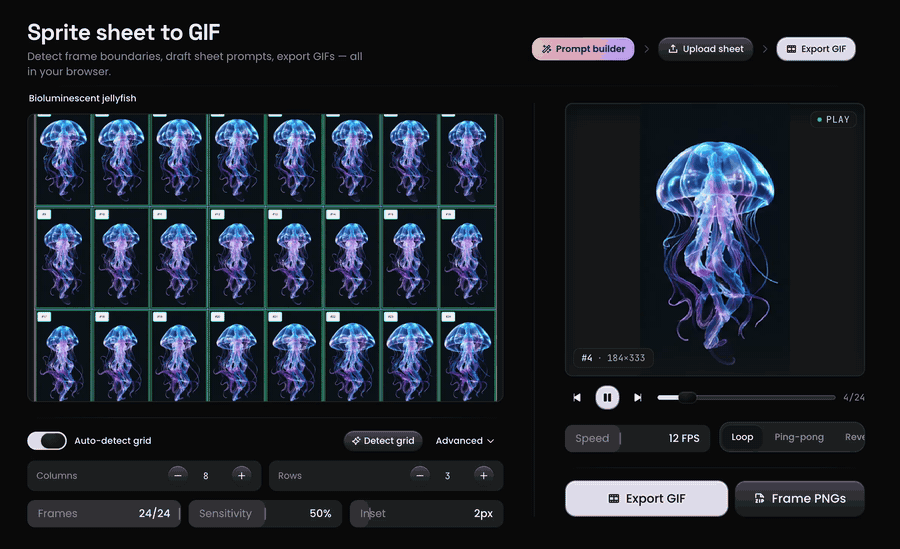

# SpriteToGIF

**Live:** [sprite-to-gif.vercel.app](https://sprite-to-gif.vercel.app/) · **Source:** [github.com/devyanshyadav/sprite-to-gif](https://github.com/devyanshyadav/sprite-to-gif/)

Turn sprite sheets into GIFs in the browser—grid detection, live preview, and export. Nothing is uploaded; processing stays on your device.

Load PNG, JPG, or WebP (or draft a sheet with the **prompt builder**). The studio detects frame cells—including **neon-green** AI grid lines—previews with the same clarity pass used at export, then writes a GIF or a ZIP of frame PNGs.



## Features

- **Grid detection** — Smart CV with gutter/padding analysis, neon-line scoring, and per-cell refine; manual columns, crops, and inset when needed.
- **Frames** — Click to select, Shift-click to skip; loop, ping-pong, or reverse preview.
- **Sharp export** — Nearest-neighbor slicing and a luminance-gated clarity pass so scaled frames do not soft-blur in preview or GIF.
- **Prompt builder** — Grid-locked spec for AI sprite sheets; copy or open in Gemini, ChatGPT, or Grok.
- **Samples & vault** — Bundled demo sheets; save GIFs to IndexedDB on this browser.

## Development

Requires [Bun](https://bun.sh) 1.3+ (npm/pnpm work with the same scripts).

```bash
git clone https://github.com/devyanshyadav/sprite-to-gif.git
cd sprite-to-gif
bun install
bun dev
```

| Command | Description |
| --- | --- |
| `bun run build` / `start` | Production build and server |
| `bun run lint` | ESLint |
| `bun run test` | Vitest |

On Vercel, set `NEXT_PUBLIC_SITE_URL=https://sprite-to-gif.vercel.app` (Project → Settings → Environment Variables). For local SEO preview, use `.env.local` (see `.env.example`).

### Add a sample

Put the file in `public/samples/` and register it in `SAMPLE_SPRITE_SHEETS` inside `lib/constants.ts` with a label like `Title · 9×3 (27 frames)`.

## Contributing

See [CONTRIBUTING.md](./CONTRIBUTING.md).

## License

[MIT](./LICENSE) © [Devyansh](https://devyanshyadav.com)
